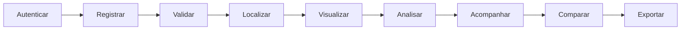

---
aliases:
  - Início
  - Igarapé Vivo
tags:
  - igarape-vivo
  - documentação
tipo: índice
status: atual
---

# Igarapé Vivo

> [!abstract] Sobre o projeto
> Sistema colaborativo para registrar, localizar, acompanhar, analisar e exportar ocorrências georreferenciadas de resíduos sólidos em corpos d'água urbanos.

## Navegação

### Início

- [[00 - Início]]

### Relatório

- [[Relatório - Igarapé Limpo]]

### Produto

- [[Visão Geral]]
- [[Funcionalidades e Fluxos]]
- [[Glossário]]

### Guia de uso

- [[Instalação e Execução]]
- [[Utilização do Sistema]]
- [[Apresentação e Demonstração]]

### Arquitetura

- [[Visão Arquitetural]]
- [[Backend]]
- [[Frontend]]
- [[Modelo de Dados]]

### Referência

- [[API HTTP]]
- [[Autenticação e Permissões]]
- [[Configuração]]
- [[Integrações Externas]]

### Operação

- [[Testes e Qualidade]]
- [[Segurança e Privacidade]]
- [[Implantação]]

### Evolução

- [[Metodologia de Campo]]
- [[Limitações e Dívida Técnica]]
- [[Roadmap]]

## Estado atual

As fases de fundamentos, monitoramento, gestão, dados, qualidade e documentação estão implementadas. A próxima etapa é a pesquisa e validação em campo.

O sistema atual é um **protótipo funcional**. Os registros incluídos no banco são dados seed e de teste, não resultados de uma coleta ambiental formal.

## Fluxo central

## Atalhos

- Para executar o projeto: [[Instalação e Execução]]
- Para conhecer os endpoints: [[API HTTP]]
- Para compreender as camadas: [[Visão Arquitetural]]
- Para consultar as entidades: [[Modelo de Dados]]
- Para verificar riscos conhecidos: [[Segurança e Privacidade]]
- Para acompanhar os próximos passos: [[Roadmap]]

## Fontes do repositório

Esta base foi consolidada a partir do código e dos documentos ativos `README.md`, `ARQUITETURA.md`, `APRESENTACAO.md` e `TODO.MD`. Em caso de divergência, o comportamento observado no código é tratado como fonte principal.

> [!info] Como abrir
> No Obsidian, use **Abrir pasta como cofre** e selecione `docs/obsidian`.
