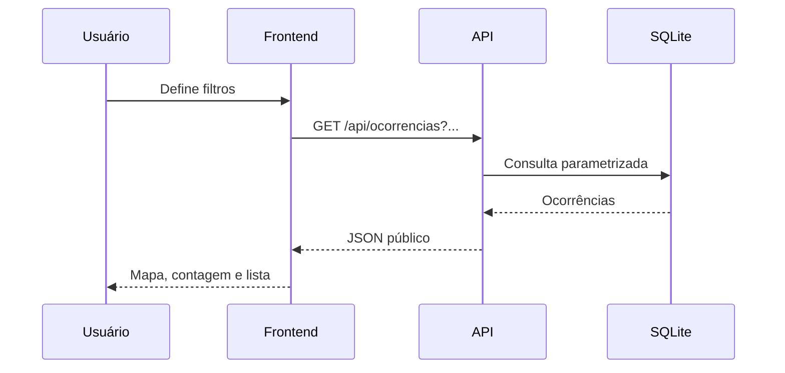
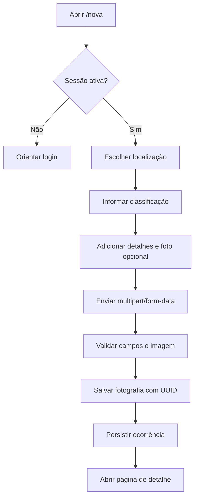

---
tags:
  - produto
  - fluxos
tipo: funcional
status: atual
---

# Funcionalidades e Fluxos

## Mapa e consulta

A página inicial consulta ocorrências pela API e apresenta marcadores agrupados, resumo do recorte e lista recente. Os filtros de tipo, nível, ponto, período e texto podem ser combinados.

Os links de exportação recebem os mesmos filtros ativos no mapa.

## Autenticação

1. O visitante abre `/login`.
2. O formulário envia e-mail e senha em JSON.
3. O backend valida o hash e o estado da conta.
4. O identificador do usuário é salvo na sessão Flask.
5. A aplicação carrega o usuário da sessão em cada requisição.
6. O logout remove os dados da sessão.

Consulte [[Autenticação e Permissões]] para as regras de acesso.

## Registro de ocorrência

A localização pode vir da geolocalização do navegador, de um clique no mapa ou de um ponto monitorado existente.

## Acompanhamento de um ponto

1. A página `/ponto/<id>` carrega o ponto e até 500 ocorrências associadas.
2. O serviço calcula distribuições por tipo e nível.
3. O histórico é apresentado em ordem temporal.
4. Atualmente, o ponto é considerado recorrente quando possui pelo menos três ocorrências no histórico total.

> [!note] Janela temporal
> Existe uma referência de 90 dias na configuração do serviço, mas ela ainda não restringe o cálculo real de recorrência.

## Dashboard

O frontend consulta em paralelo:

- resumo geral;
- série temporal de 30 dias;
- ranking de pontos.

Os resultados alimentam cards e quatro visualizações Chart.js: resíduos por tipo, níveis, evolução temporal e ranking.

## Moderação

Moderadores e administradores podem excluir ocorrências e gerenciar pontos pela API. Administradores também podem criar usuários. A interface atual oferece alteração visual de status, mas não possui telas completas para usuários, pontos e exclusões.

> [!warning] Autorização atual
> Embora a interface de status seja mostrada somente a moderadores e administradores, o endpoint genérico de atualização permite que qualquer usuário autenticado envie o campo `status`.

## Exportação

- CSV: formato tabular, separado por ponto e vírgula.
- GeoJSON: `FeatureCollection` com geometria `Point` em `[longitude, latitude]`.

Veja os contratos em [[API HTTP]].
