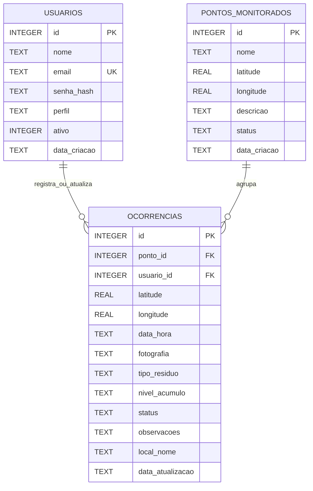

---
tags:
  - arquitetura
  - banco-de-dados
  - sqlite
tipo: referência
status: atual
---

# Modelo de Dados

## Diagrama

## `usuarios`

| Campo | Regra |
|---|---|
| `id` | Chave primária autoincremental |
| `nome` | Obrigatório, até 120 caracteres no serviço |
| `email` | Obrigatório, único, até 254 caracteres |
| `senha_hash` | Hash Werkzeug, nunca retornado publicamente |
| `perfil` | `usuario`, `moderador` ou `administrador` |
| `ativo` | `1` para ativo e `0` para inativo |
| `data_criacao` | Data criada pelo SQLite |

## `pontos_monitorados`

| Campo | Regra |
|---|---|
| `id` | Chave primária autoincremental |
| `nome` | Obrigatório, até 120 caracteres |
| `latitude` | Entre -90 e 90 |
| `longitude` | Entre -180 e 180 |
| `descricao` | Opcional, até 1000 caracteres |
| `status` | `Ativo` ou `Inativo` |
| `data_criacao` | Data criada pelo SQLite |

## `ocorrencias`

| Campo | Regra |
|---|---|
| `id` | Chave primária autoincremental |
| `ponto_id` | Referência opcional ao ponto |
| `usuario_id` | Referência opcional ao usuário, omitida da API pública |
| `latitude` | Obrigatória, entre -90 e 90 |
| `longitude` | Obrigatória, entre -180 e 180 |
| `data_hora` | Data criada pelo SQLite |
| `fotografia` | Nome interno opcional |
| `tipo_residuo` | Um dos tipos configurados |
| `nivel_acumulo` | `Baixo`, `Medio` ou `Alto` |
| `status` | Estado operacional |
| `observacoes` | Opcional, até 2000 caracteres |
| `local_nome` | Opcional, até 160 caracteres |
| `data_atualizacao` | Preenchida nas alterações |

## Índices

Instalações novas possuem índices compostos de latitude e longitude para pontos e ocorrências. Não há índices específicos para data, tipo, nível, status ou `ponto_id`.

## Domínios

Tipos de resíduo, níveis e status são listas em `config.py`, não tabelas de domínio. Consulte [[Glossário]].

## Integridade e evolução

O schema declara chaves estrangeiras, mas a ativação do SQLite é por conexão. Como `database.get_db()` não executa explicitamente `PRAGMA foreign_keys = ON`, a aplicação não garante essa validação em todas as conexões.

`database.py` aplica alterações idempotentes simples em bancos existentes. Não há histórico de migrações, versão de schema ou rollback.

## Datas e fuso

O SQLite cria datas UTC em formato textual, enquanto alguns cálculos usam o relógio local do processo. A constante `TIMEZONE = "America/Manaus"` não uniformiza automaticamente todas as operações.

## Armazenamento de fotografias

As imagens não ficam no banco. `ocorrencias.fotografia` guarda o nome do arquivo em `static/uploads`.

## Arquivos de referência

- `schema.sql`;
- `database.py`;
- `config.py`;
- `app/repositories/`.
