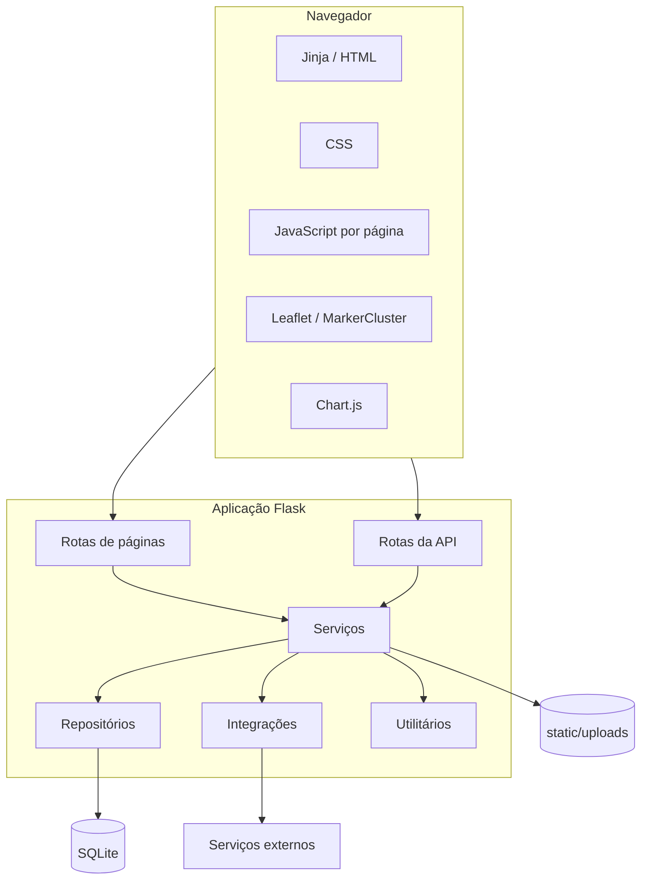
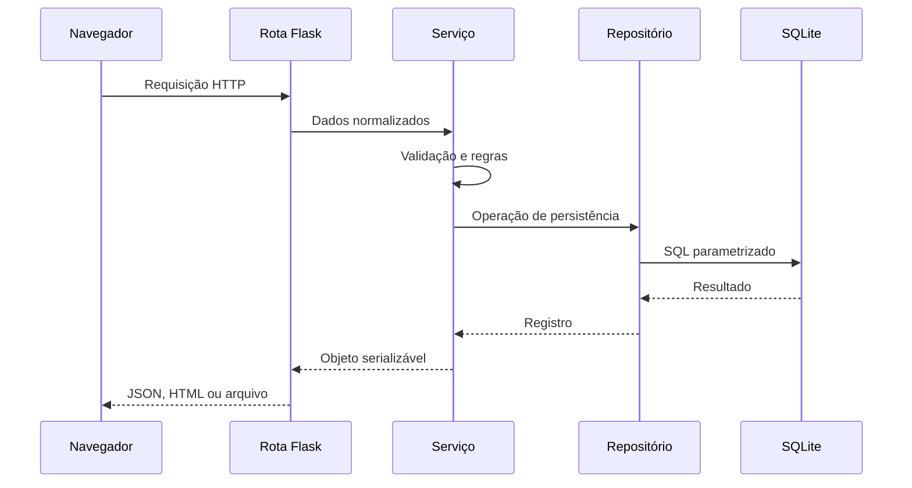

---
tags:
  - arquitetura
  - visão-geral
tipo: técnico
status: atual
---

# Visão Arquitetural

## Estilo

O Igarapé Limpo é uma aplicação web monolítica Flask, renderizada no servidor e complementada por JavaScript sem framework no navegador.



## Componentes

| Camada | Responsabilidade | Local |
|---|---|---|
| Inicialização | Factory, sessão, headers e erros | `app/__init__.py` |
| Páginas | Renderização Jinja | `app/routes/pages.py` |
| API | HTTP, JSON, multipart e exportações | `app/routes/api.py` |
| Serviços | Validação e regras de negócio | `app/services/` |
| Repositórios | Consultas SQL parametrizadas | `app/repositories/` |
| Integrações | Adaptação de serviços externos | `app/integrations/` |
| Persistência | Conexão, schema e evolução | `database.py`, `schema.sql` |
| Interface | Templates e assets | `templates/`, `static/` |

## Estrutura principal

```text
igarape-limpo/
├── app.py
├── config.py
├── database.py
├── schema.sql
├── app/
│   ├── __init__.py
│   ├── routes/
│   ├── services/
│   ├── repositories/
│   ├── integrations/
│   └── utils/
├── templates/
├── static/
│   ├── css/
│   ├── js/
│   └── uploads/
└── tests/
```

## Fluxo de uma requisição



## Decisões e trade-offs

- Flask e JavaScript puro reduzem a complexidade inicial.
- SQLite facilita demonstração local, mas limita concorrência e escala.
- Upload local é simples, mas impede escalabilidade horizontal direta.
- Separar rotas, serviços e repositórios mantém regras fora do transporte HTTP.
- Leaflet e OpenStreetMap evitam chave comercial.
- CDNs simplificam os assets, mas tornam parte da interface dependente de rede.
- Evoluções idempotentes em `database.py` atendem o protótipo, mas não substituem migrações versionadas.

## Notas relacionadas

- [[Backend]]
- [[Frontend]]
- [[Modelo de Dados]]
- [[Implantação]]
